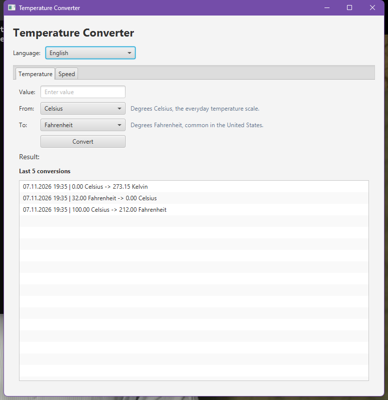
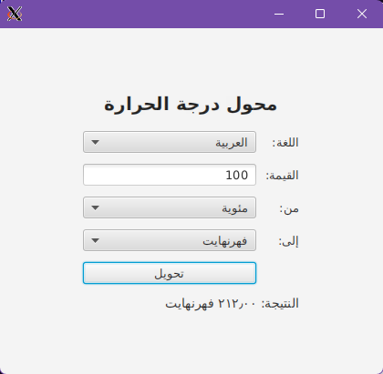
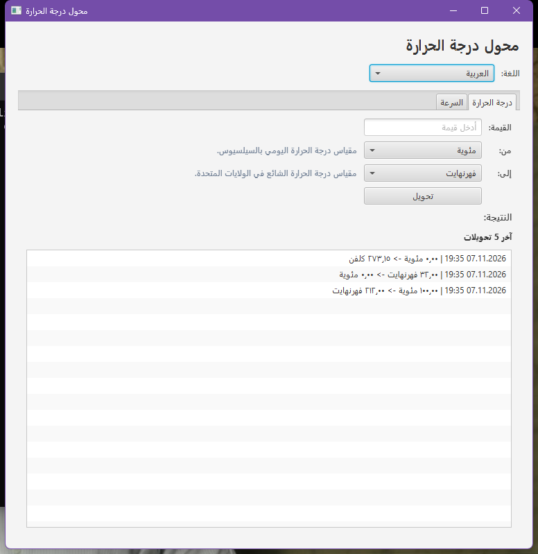
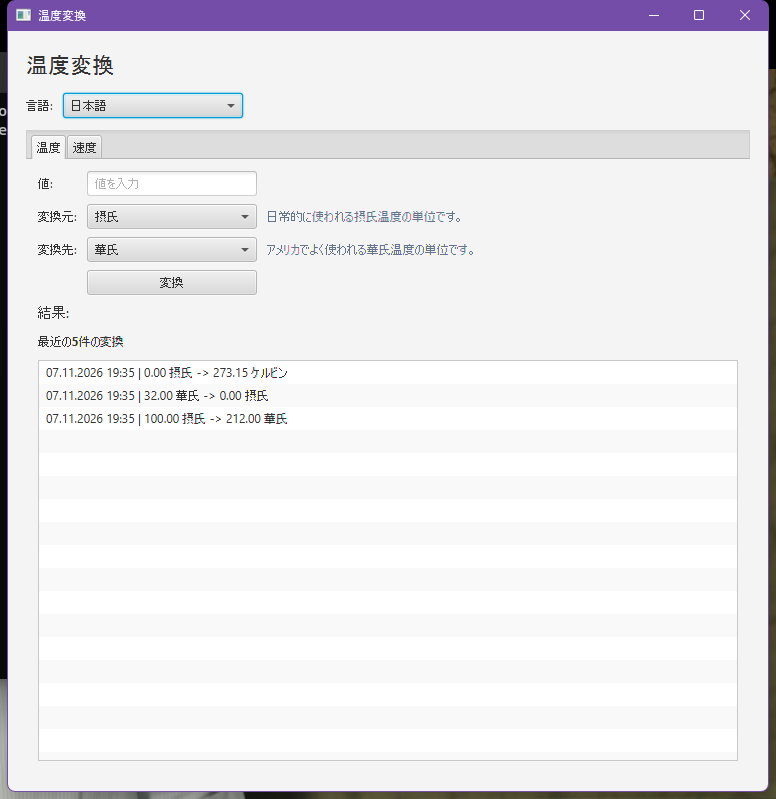
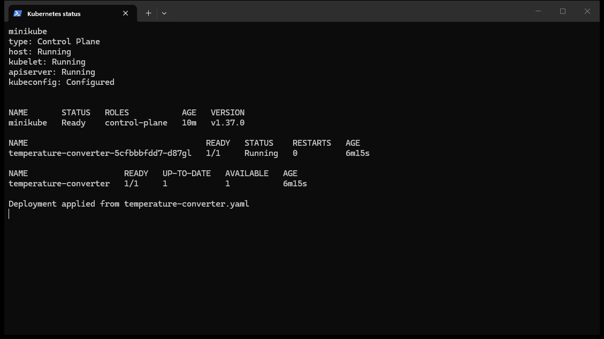
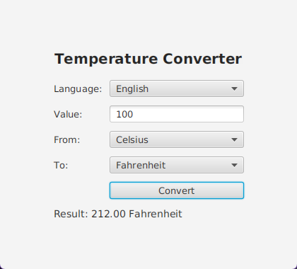
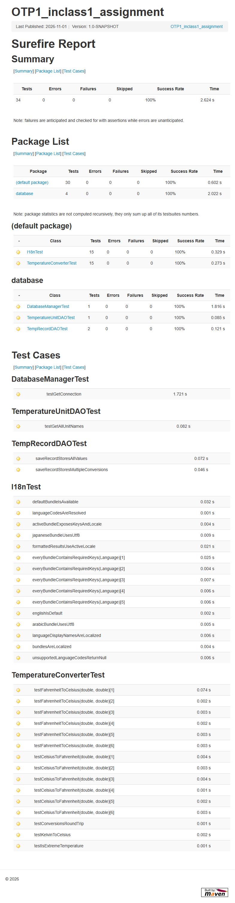
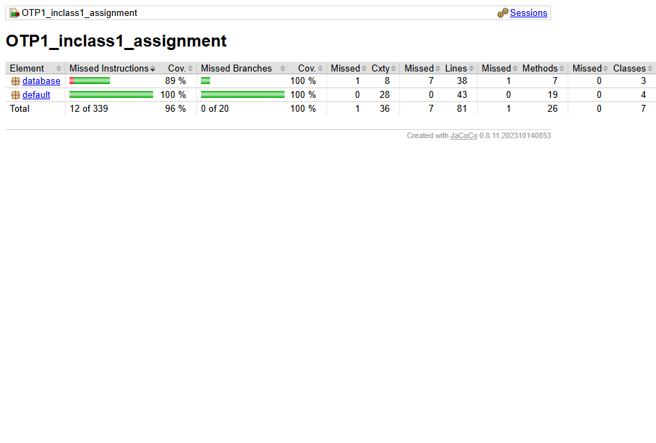
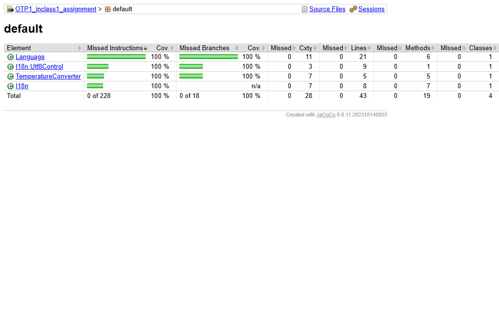

# Temperature Converter

## 1. Assignment Description

This project implements a temperature conversion application with a JavaFX graphical user interface. The interface can be switched between English, Finnish, Swedish, Japanese, and Arabic at runtime. In addition to temperature conversion, the application contains a speed calculator that uses distance and time measurements.

The supported temperature units are Celsius, Fahrenheit, and Kelvin. The speed calculator supports metres per second, kilometres per hour, and miles per hour, combined with metre/kilometre/mile distance units and second/minute/hour time units.

The application stores conversion records and speed measurements in a local H2 database. Unit names and short unit descriptions are localized in the database using a translation table, while static UI texts are localized with `.properties` resource bundles. The latest five temperature conversions and the latest five speed calculations are shown in the GUI.

### Main requirements addressed

- Implement a FXML-based JavaFX user interface for temperature conversion and speed calculation.
- Support conversions between Celsius, Fahrenheit, and Kelvin.
- Calculate speed from distance and time.
- Provide a localized user interface in English, Finnish, Swedish, Japanese, and Arabic.
- Allow the user to change the language dynamically without restarting the application.
- Load static UI texts from UTF-8 encoded `.properties` resource bundles.
- Store localized unit names and descriptions in the database using one database localization approach.
- Provide speed, distance, and time measurement tables with foreign-key relationships.
- Read and write speed, distance, and time measurements through the GUI.
- Use right-to-left layout for Arabic.
- Validate numeric user input.
- Display converted values with two decimal places.
- Save each conversion with its value, units, result, language, and timestamp, and show the latest five records in the GUI.
- Initialize the database from `init.sql` automatically when the application starts.
- Provide automated unit tests for the conversion logic, localization, database access, and English fallback.
- Enforce at least 80% line coverage for the measured core logic with JaCoCo.
- Provide Maven, Docker, Jenkins, and Kubernetes support.

## 2. Technologies & Tools Used

### Programming languages

- Java 17
- HTML
- JavaScript
- CSS
- Groovy, for the Jenkins pipeline

### Libraries and frameworks

- JavaFX 21.0.2
    - `javafx-controls`
    - `javafx-fxml`
    - `javafx-graphics`
    - `javafx-base`
- H2 Database 2.2.224
- JUnit Jupiter 5.13.4
- JaCoCo 0.8.11
- Java `ResourceBundle` / `PropertyResourceBundle` for localization

### Development and build tools

- Apache Maven 3.9 or newer
- Java Development Kit 17
- Docker
- Jenkins
- Minikube and kubectl
- XMing or another X server for running the GUI from a container
- Git and GitHub
- IntelliJ IDEA project configuration

## 3. Design Approach & Implementation Method

### Application structure

The application is divided into four main areas:

1. Graphical user interface
2. Localization of static UI text and database data
3. Temperature and speed conversion logic
4. Database access

The main application classes are located in `src/main/java`. The localized messages are located in `src/main/resources`.

### Graphical user interface

The GUI is implemented with JavaFX and FXML. The layout is defined in `src/main/resources/TempConverter.fxml`, and the UI logic is handled by `TempConverterController`.

The application window contains:

- A language selector with English, Finnish, Swedish, Japanese, and Arabic
- A temperature tab with a value field, source unit, target unit, conversion button, result label, and the latest five conversions
- A speed tab with distance and time fields, distance/time/speed unit selectors, a calculation button, result label, and the latest five speed calculations
- A short description for every selected unit, read from the database

All static labels, prompts, buttons, window titles, and error messages are loaded from the selected resource bundle. The FXML file uses resource-bundle keys such as `%app.title` and `%button.convert`.

Unit names and unit descriptions are not stored in the `.properties` files. They are loaded from the `unit` and `unit_translation` tables through `UnitDAO` for the language currently selected in the GUI. This keeps the static UI layer and the localized data layer separate.

Changing the language reloads the FXML view with the selected `ResourceBundle` and re-queries the database for the selected language. The language change is applied immediately, and no application restart is required. Arabic also switches the scene to right-to-left orientation.

The application starts from the `Launcher` class, which starts `TempConverterApp`. `TempConverterApp` calls `DatabaseManager.initializeDatabase()` before displaying the user interface. The schema and seed data are read from the repository-level `init.sql` file, which is copied to the application classpath during the Maven build.

### Localization

Localization is implemented with Java `ResourceBundle` and `PropertyResourceBundle`. The bundles are always read as UTF-8 by a custom `ResourceBundle.Control`, so the Japanese and Arabic texts do not need Unicode escape sequences.

The project contains the following UTF-8 properties files:

| File | Language |
|---|---|
| `MessagesBundle_en_US.properties` | English (default) |
| `MessagesBundle_fi_FI.properties` | Finnish |
| `MessagesBundle_sv_SE.properties` | Swedish |
| `MessagesBundle_ja_JP.properties` | Japanese |
| `MessagesBundle_ar_SA.properties` | Arabic |
| `MessagesBundle.properties` | English fallback |

The `Language` enum defines the supported locales. The `I18n` class loads the bundle for the selected locale and exposes the localized strings and locale-aware formatting to the UI.

The language selector in the FXML view changes the active `ResourceBundle` at runtime. When Arabic is selected, the scene orientation is set to right-to-left, and the result is formatted with the Arabic locale. The same selected language code is passed to `UnitDAO`, `ConversionDAO`, and `MeasurementDAO`, so both the UI texts and the unit names/descriptions change together.

### Temperature and speed conversion

The temperature conversion logic is implemented in the `TemperatureConverter` class. The following conversions are supported:

- Fahrenheit to Celsius
- Celsius to Fahrenheit
- Kelvin to Celsius
- Detection of extreme Celsius temperatures

The GUI supports conversion between all three temperature units by using the conversion factors and offsets stored in the `unit` table. The speed calculator uses the `UnitConverter` class to convert distance and time to base units and then to the selected speed unit. The formulas are:

```text
temperature: base = value * factor_to_base + offset_to_base
linear unit: result = value * from_factor / to_factor
speed:       result = (distance * distance_factor) / (time * time_factor) / speed_factor
```

Values are displayed using two decimal places and the number formatting conventions of the selected locale. The input parser also accepts a comma decimal separator and Arabic-Indic digits.

### Database design

The application uses an H2 file-based database stored in the `data` directory. The schema is defined in the repository-level `init.sql` file and is executed automatically at application startup.

The chosen database localization approach is a **translation table**. Base unit information is stored once in `unit`, and each localized name and description is stored in `unit_translation` with a language code. The database does not use separate language columns in the unit table, duplicate unit rows for each language, or one table per language.

#### `unit`

Stores the language-independent information for every unit.

| Column | Description |
|---|---|
| `unit_id` | Unique identifier |
| `unit_key` | Stable key such as `celsius` or `kilometer` |
| `category` | `TEMPERATURE`, `SPEED`, `DISTANCE`, or `TIME` |
| `symbol` | Symbol such as `°C`, `km/h`, or `min` |
| `factor_to_base` | Multiplier that converts the unit to the base unit |
| `offset_to_base` | Offset used by temperature scales |
| `display_order` | Order of the unit in the GUI selector |

#### `unit_translation`

Stores the localized name and short description for every unit and language.

| Column | Description |
|---|---|
| `unit_id` | Reference to `unit.unit_id` |
| `lang` | Language code: `en`, `fi`, `sv`, `ja`, or `ar` |
| `name` | Localized unit name shown in the GUI |
| `description` | Localized short description shown below the selector |

The primary key is `(unit_id, lang)`, and `unit_id` is a foreign key to `unit`. The seed data contains 12 units and 60 translations: five languages for each unit.

#### `conversion_history`

Stores completed temperature conversions.

| Column | Description |
|---|---|
| `conversion_id` | Unique identifier |
| `input_value` | Original value |
| `from_unit_id` | Source unit, foreign key to `unit` |
| `to_unit_id` | Target unit, foreign key to `unit` |
| `result_value` | Converted value |
| `language_code` | Language active during the conversion |
| `created_at` | Timestamp of the conversion |

#### `distance_measurement`, `time_measurement`, and `speed_measurement`

These three tables form the measurement data model required by the assignment.

| Table | Important columns |
|---|---|
| `distance_measurement` | `distance_id`, `measurement_value`, `unit_id`, `recorded_at` |
| `time_measurement` | `time_id`, `measurement_value`, `unit_id`, `recorded_at` |
| `speed_measurement` | `speed_id`, `distance_id`, `time_id`, `speed_value`, `speed_unit_id`, `language_code`, `recorded_at` |

`distance_measurement.unit_id`, `time_measurement.unit_id`, and `speed_measurement.speed_unit_id` reference `unit.unit_id`. `speed_measurement.distance_id` references `distance_measurement.distance_id`, and `speed_measurement.time_id` references `time_measurement.time_id`. The GUI writes one row to each measurement table whenever the user calculates a speed, and it reads the latest calculations back for the history list.

### Why the translation-table approach was chosen

The translation table was selected because it keeps the unit data normalized and makes adding a language a data-only operation. A new language requires one new `unit_translation` row per unit (12 rows for the current unit set), not changing the table structure and not duplicating conversion factors. The base unit table remains the single source of truth for symbols and conversion factors.

The `UnitDAO` query joins `unit` with `unit_translation` for the selected language and with an English translation as a fallback:

```sql
LEFT JOIN unit_translation t ON t.unit_id = u.unit_id AND t.lang = ?
LEFT JOIN unit_translation e ON e.unit_id = u.unit_id AND e.lang = 'en'
```

The selected name and description use `COALESCE(t.name, e.name)` and `COALESCE(t.description, e.description)`. This means an incomplete translation automatically falls back to English, which satisfies the required fallback behaviour. The same query pattern is used for conversion history and speed measurements.

The field approach would add one column per language to the unit table, making the schema wider for every new language. The row approach would duplicate unit facts in every localized row. A table per language would duplicate the unit identifier and conversion factor in several tables. The translation table avoids those problems while still allowing the language selector to switch the database query language at runtime.

### Database access

Database operations are separated into DAO classes:

- `UnitDAO` retrieves localized unit names and descriptions by category.
- `ConversionDAO` saves temperature conversions and reads the latest conversions.
- `MeasurementDAO` saves distance, time, and speed measurements and reads the latest speed calculations.
- `DatabaseManager` creates the database connection and executes `init.sql`.
- `UnitConverter` contains the conversion and speed calculation logic.

Prepared statements are used for all user-supplied values. The DAO classes request the selected language code from the controller, so changing the language changes both the resource bundle and the database query.

### Build and deployment approach

Maven is used to:

- Compile the Java source code
- Download project dependencies
- Copy the UTF-8 resource bundles into the application
- Run automated tests
- Generate JaCoCo code coverage reports
- Enforce 100% line and branch coverage for `TemperatureConverter`
- Enforce at least 80% line coverage for the measured core classes (DAO, conversion, localization, and database code)
- Build an executable shaded JAR file

A Dockerfile is included to create a containerized version of the application. The Docker build uses a multi-stage build, runs `mvn clean verify` (including tests and JaCoCo checks), and packages the application together with its dependencies. The runtime image uses a UTF-8 locale so the localized texts are handled correctly.

A Jenkins pipeline is also included. It performs the following stages:

1. Checkout
2. Build and test (`mvn clean verify`)
3. Publish test results
4. Publish coverage results
5. Archive the JaCoCo report
6. Build the Docker image
7. Verify the Docker image
8. Publish the image to Docker Hub

The pipeline pushes `junkkari/temperature-converter-gui:latest` using the Jenkins credentials ID `dockerhub-credentials`.

A Kubernetes manifest is provided in `temperature-converter.yaml`. It defines a Deployment that runs the Docker image with an X11 `DISPLAY` variable so the JavaFX window can be shown through XMing or another X server.

## 4. Testing & Quality Assurance Steps

### Automated tests

The project uses JUnit 5 for automated testing.

The tests cover the following functionality:

| Test area | Test scenarios | Expected result |
|---|---|---|
| Fahrenheit-to-Celsius conversion | `32°F`, `212°F`, `-40°F`, `0°F`, `98.6°F`, `451°F` | Correct Celsius values are returned |
| Celsius-to-Fahrenheit conversion | `0°C`, `100°C`, `-40°C`, `37°C`, `-273.15°C`, `50°C` | Correct Fahrenheit values are returned |
| Conversion round-trip | Several Celsius values converted to Fahrenheit and back | The original value is returned within the tolerance |
| Kelvin-to-Celsius conversion | `300 K`, `273.15 K`, and `0 K` | Correct Celsius values are returned |
| Extreme temperature detection | Boundary values `-40` and `50`, edge cases `-41` and `51`, and interior values | Correctly identifies extreme temperatures |
| Unit conversion factors | Temperature, distance, and time unit combinations | Correct converted values are returned |
| Speed calculation | Kilometres and minutes to km/h, kilometres and hours to m/s, miles and hours to mph | Correct speed values are returned |
| Invalid speed input | Zero time, negative distance, wrong unit categories, and non-finite values | `IllegalArgumentException` is thrown |
| Localization bundles | All five locales | Every bundle contains all required UI keys and the same key set |
| UTF-8 encoding | Japanese and Arabic bundles | Non-Latin texts are read correctly without Unicode escapes |
| Language selection | Language codes such as `ja_JP`, `fi-FI`, `sv_SE`, and `ar-SA` | Correct `Language` value is resolved |
| Locale-aware formatting | English and Finnish result patterns | Decimal separators follow the active locale |
| Database connection and schema | Initialize the database twice and inspect the tables | Schema creation is idempotent; 12 units and 60 translations are present |
| Localized unit DAO | English, Finnish, Swedish, Japanese, and Arabic unit lookups | Correct localized names and descriptions are returned |
| English fallback | Unknown language and a missing translation row | English name and description are returned |
| Conversion history DAO | Save conversions in several languages and read the latest rows | Values, localized names, language, and timestamp are stored correctly |
| Measurement DAO | Save distance, time, and speed rows and read the latest calculations | All three related tables and localized names are used correctly |

The test suite contains 70 JUnit 5 tests. The temperature conversion tests use a tolerance of `0.001` to account for floating-point calculation differences.

JaCoCo enforces 100% line and branch coverage for `TemperatureConverter` and at least 80% line coverage for the measured core classes. The generated report currently covers 94.6% of the measured core lines (212 covered, 12 missed). The JavaFX entry points (`TempConverterApp`, `TempConverterController`, and `Launcher`) are excluded from the coverage report because they require a display; they are verified manually.

### Manual testing

The graphical user interface can be tested manually using the following scenarios:

1. Enter a valid Celsius value and convert it to Fahrenheit.
2. Enter a valid Fahrenheit value and convert it to Celsius.
3. Enter a valid Kelvin value and convert it to Celsius.
4. Convert a temperature between all supported unit combinations.
5. Confirm that the selected unit descriptions are shown below the selectors and that they come from the database.
6. Leave the input empty and click **Convert**.
7. Enter non-numeric input and click **Convert**.
8. Confirm that an error message is displayed for invalid input.
9. Confirm that valid conversions are displayed with two decimal places.
10. Confirm that a conversion creates a row in `conversion_history` and appears in the latest-five list.
11. Open the speed tab, enter a distance and time, select the units, and click **Calculate speed**.
12. Confirm that the speed result is correct and that rows are created in `distance_measurement`, `time_measurement`, and `speed_measurement`.
13. Confirm that the latest speed calculations appear in the speed history list.
14. Change the language with the language selector and confirm that the labels, the window title, the unit names, and the unit descriptions update immediately.
15. Select Arabic and confirm that the layout switches to right-to-left and the result uses Arabic text and digits.
16. Temporarily remove one translation row and confirm that the GUI falls back to the English name and description.

### Build verification

The following Maven commands are used for quality assurance:

```bash
mvn clean verify
mvn test
mvn jacoco:report
```

`mvn clean verify` runs the tests, generates the JaCoCo report, checks the coverage rules, copies `init.sql` into the classpath, and builds the shaded JAR. The coverage report is written to `target/site/jacoco/index.html`, and the Surefire report is written to `target/reports/surefire.html`.

The Maven build also creates a shaded JAR containing the application and its dependencies.

## 5. How to Run

### Prerequisites

Install the following software:

- JDK 17 or newer
- Apache Maven 3.9 or newer
- Git

For the Docker option:

- Docker Desktop or Docker Engine

### Clone the repository

```bash
git clone https://github.com/LasperKaine/Ohjelmistotuotantoprojekti1.git
cd Ohjelmistotuotantoprojekti1
```

### Run the automated tests

```bash
mvn test
```

### Build the application

```bash
mvn clean verify
```

The generated JAR file is created in the `target` directory.

### Run the application with Maven

On Windows, run:

```bash
mvn javafx:run
```

The Maven configuration uses the Windows JavaFX platform by default.

On Linux, use:

```bash
mvn -Djavafx.platform=linux javafx:run
```

When the application starts, the language can be changed from the language selector in the main window. The default is English.

### Run the packaged JAR

After building the project, run:

```bash
java -jar target/OTP1_inclass1_assignment-1.0-SNAPSHOT.jar
```

The initial language can be selected with a system property or a command-line argument. The language can still be changed at runtime from the language selector:

```bash
java -Dapp.locale=ja_JP -jar target/OTP1_inclass1_assignment-1.0-SNAPSHOT.jar
java -jar target/OTP1_inclass1_assignment-1.0-SNAPSHOT.jar --lang=fi_FI
```

Supported language codes are `en_US`, `fi_FI`, `sv_SE`, `ja_JP`, and `ar_SA` (the short forms `en`, `fi`, `sv`, `ja`, and `ar` are also accepted).

### Build and run with Docker

Build the Docker image:

```bash
docker build -t temperature-converter-gui .
```

The Docker build runs the unit tests, generates the JaCoCo report, and verifies the coverage rules before packaging the application.

Run the container with XMing on Windows. Start XMing first, allow client connections, and then run:

```bash
docker run --rm -e DISPLAY=host.docker.internal:0.0 -e JAVA_TOOL_OPTIONS='-Dprism.order=sw' temperature-converter-gui
```

On Linux, use the X11 socket:

```bash
docker run --rm -e DISPLAY=$DISPLAY -v /tmp/.X11-unix:/tmp/.X11-unix -e JAVA_TOOL_OPTIONS='-Dprism.order=sw' temperature-converter-gui
```

The Docker image uses Java 17 and installs the native libraries required by JavaFX. The runtime container uses a UTF-8 locale for the localized texts.

### Run with Kubernetes and Minikube

Start Minikube and load the image into the cluster:

```bash
minikube start
minikube image load junkkari/temperature-converter-gui:latest
```

Apply the provided manifest:

```bash
kubectl apply -f temperature-converter.yaml
kubectl get pods
```

The manifest sets `DISPLAY=host.docker.internal:0.0` so the JavaFX window can be shown through XMing. If the image is published to Docker Hub, `minikube image load` can be omitted and Kubernetes pulls `junkkari/temperature-converter-gui:latest` directly.

The deployment was verified with Minikube on Windows. The pod reached the `Running` state and the application window was displayed through Xming. See `docs/kubernetes-xming.png`.

To remove the deployment:

```bash
kubectl delete -f temperature-converter.yaml
```

## 6. Assignment Screenshots

The `docs` directory contains screenshots produced from the final build:

### English localized application



### Arabic localized application running inside Xming



### Arabic localized application on Windows



### Japanese localized application



### Minikube cluster and running deployment



### Application deployed with Minikube and shown through Xming



### Successful test execution



### JaCoCo coverage report



### JaCoCo default package details



## 7. In-class Assignment 6 Submission

- GitHub repository: <https://github.com/LasperKaine/Ohjelmistotuotantoprojekti1>
- Docker Hub image: `junkkari/temperature-converter-gui:latest`
- Docker Hub page: <https://hub.docker.com/r/junkkari/temperature-converter-gui>
- Xming screenshots: `docs/docker-xming-ar.png` and `docs/kubernetes-xming.png`
- Minikube verification screenshot: `docs/kubernetes-status.png`
- Localization screenshots: `docs/localization-en.png`, `docs/localization-ar.png`, and `docs/localization-ja.png`
- Test and coverage screenshots: `docs/surefire-tests.png`, `docs/jacoco-coverage.png`, and `docs/jacoco-default-package.png`
- Kubernetes manifest: `temperature-converter.yaml`
- Database schema and localization seed data: `init.sql`
- Written database-localization justification: `docs/database-localization.md` and Section 3 of this README

The Docker Hub image is published by the Jenkins pipeline using the `dockerhub-credentials` credentials ID.

# Database Localization Approach

## Chosen approach: translation table

The project uses a **translation table** for database localization. Language-independent unit data is stored once in `unit`, and each localized name and short description is stored in `unit_translation`.

```text
unit
  unit_id, unit_key, category, symbol, factor_to_base, offset_to_base, display_order

unit_translation
  unit_id, lang, name, description
  primary key (unit_id, lang)
  foreign key (unit_id) -> unit(unit_id)
```

The database stores five languages (`en`, `fi`, `sv`, `ja`, `ar`) for every unit. The current seed data contains 12 units and 60 translation rows.

## Why this approach was chosen

The translation table keeps the unit facts and the translations separate:

- Conversion factors and symbols are stored only once per unit.
- Adding a language requires inserting translation rows, not changing the table structure.
- The unit table does not become wider when a new language is added.
- The same pattern is used for unit names, descriptions, and history queries.
- It avoids duplicating conversion factors in every localized row, which would happen with a row-based approach.
- It avoids creating one table per language.

The static GUI labels are still localized with `.properties` resource bundles. Only localized *data* is stored in the database, which matches the assignment requirement.

## English fallback

`UnitDAO` joins the selected language and English, then uses `COALESCE` to select the first available value:

```sql
LEFT JOIN unit_translation t
       ON t.unit_id = u.unit_id AND t.lang = ?
LEFT JOIN unit_translation e
       ON e.unit_id = u.unit_id AND e.lang = 'en'
...
COALESCE(t.name, e.name) AS name,
COALESCE(t.description, e.description) AS description
```

If a translation row or one of its fields is missing, the English value is returned. The same fallback pattern is used by `ConversionDAO` and `MeasurementDAO` for the history lists.

## Measurement tables

The speed calculator writes measurements to three related tables:

- `distance_measurement` stores the distance value and its unit.
- `time_measurement` stores the time value and its unit.
- `speed_measurement` references both measurement rows and stores the calculated speed, speed unit, language, and timestamp.

The GUI reads the latest speed calculations back from these tables and displays them in the speed history list. Temperature conversions are stored in `conversion_history` with the input value, source unit, target unit, result, language, and timestamp.

## Verification

- `mvn clean verify` runs the test suite and the JaCoCo coverage checks.
- `UnitDAOTest` verifies English, Finnish, Swedish, Japanese, and Arabic names and the English fallback.
- `ConversionDAOTest` and `MeasurementDAOTest` verify that localized names and related measurement rows are stored and read correctly.
- `DatabaseManagerTest` verifies that `init.sql` is idempotent and creates 12 units and 60 translations.


## Project Structure

```text
.
├── data/
│   └── tempconverter.mv.db
├── docs/
│   ├── database-localization.md
│   ├── docker-xming-ar.png
│   ├── jacoco-coverage.png
│   ├── jacoco-default-package.png
│   ├── kubernetes-status.png
│   ├── kubernetes-xming.png
│   ├── localization-ar.png
│   ├── localization-en.png
│   ├── localization-ja.png
│   └── surefire-tests.png
├── init.sql
├── src/
│   ├── main/
│   │   ├── java/
│   │   │   ├── I18n.java
│   │   │   ├── Language.java
│   │   │   ├── Launcher.java
│   │   │   ├── TempConverterApp.java
│   │   │   ├── TempConverterController.java
│   │   │   ├── TemperatureConverter.java
│   │   │   ├── UnitConverter.java
│   │   │   └── database/
│   │   │       ├── ConversionDAO.java
│   │   │       ├── ConversionRecord.java
│   │   │       ├── DatabaseManager.java
│   │   │       ├── MeasurementDAO.java
│   │   │       ├── SpeedRecord.java
│   │   │       ├── Unit.java
│   │   │       └── UnitDAO.java
│   │   └── resources/
│   │       ├── MessagesBundle.properties
│   │       ├── MessagesBundle_ar_SA.properties
│   │       ├── MessagesBundle_en_US.properties
│   │       ├── MessagesBundle_fi_FI.properties
│   │       ├── MessagesBundle_ja_JP.properties
│   │       ├── MessagesBundle_sv_SE.properties
│   │       └── TempConverter.fxml
│   └── test/
│       └── java/
│           ├── I18nTest.java
│           ├── TemperatureConverterTest.java
│           ├── UnitConverterTest.java
│           └── database/
│               ├── ConversionDAOTest.java
│               ├── DatabaseManagerTest.java
│               ├── MeasurementDAOTest.java
│               └── UnitDAOTest.java
├── .dockerignore
├── .gitignore
├── Dockerfile
├── Jenkinsfile
├── pom.xml
├── README.md
└── temperature-converter.yaml
```